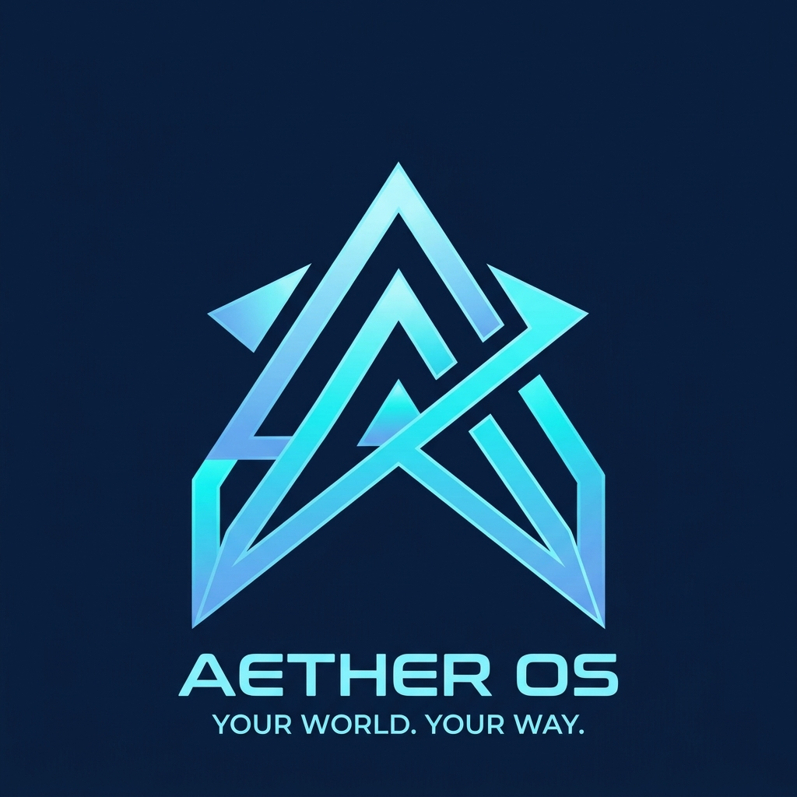

# AetherOS

  

**A customizable Linux desktop with a futuristic edge.**

AetherOS is an experimental operating system project built on Debian 13. It aims to pair a distinctive visual identity and a more customizable desktop with Debian's established Linux foundation.

## What exists today

- A hybrid BIOS/UEFI live image built with Debian live-build.
- A KDE Plasma-based desktop prototype with the Aether Dock, custom icons, and wallpaper.
- A GTK Welcome guide with links to desktop setup and included applications.
- A Debian installer and QEMU-tested BIOS/UEFI installation paths.
- Automated checks and VM testing tools for the ISO, desktop, dock, and greeter.

The current desktop is a stepping stone toward a more original Aether Shell; this is not yet a complete custom desktop environment.

## Current status

The desktop and installer have been exercised in disposable QEMU virtual machines. Aether Welcome has been opened and its pages rendered in a UEFI live session.

**This is a development build, not a beta release.** The current Welcome-test image still opens KDE's generic Welcome Center at startup. Aether Welcome's installed first-run behavior and completion persistence have not been verified, and real-hardware compatibility has not been established. No ISO is published for download yet.

## Roadmap

1. Resolve the KDE Welcome startup conflict and verify Aether Welcome after installation and on repeat login.
2. Grow Aether Shell beyond the current dock and Plasma integration, with more customization and desktop features.
3. Build first-party applications such as Aether Store and Aether Settings.
4. Improve installation, accessibility, update, and hardware testing before considering a public beta.

## Build and test

Build instructions: [docs/BUILD.md](docs/BUILD.md)

VM testing and VirtualBox profile: [docs/VM_TESTING.md](docs/VM_TESTING.md)
Detailed original project requirements and development tracking: [DEVELOPMENT_README.md](DEVELOPMENT_README.md)

The ISO is generated locally and excluded from Git. Do not install to a physical disk for testing; use a disposable virtual machine and verify its virtual disk before confirming any partitioning.

Once AetherOS is in version 1.0, i will release the operating system as a single .iso file to make installing it way easier. Stay Tuned!

## Contributing

This project is under active development. Issues and focused contributions are welcome; please include reproduction steps and test results for bug reports.
